<!-- TODO(EGO): when the first extensions.gnome.org upload has an id, add the link to step 0 (Install). Until then there is no such link. -->

<h1 align="center">
  <picture>
    <source media="(prefers-color-scheme: dark)" srcset="docs/screenshots/readme-c-tour-dark.svg">
    
  </picture>
</h1>

<p align="center">
  <b>Dictation Indicator for Voxtype</b> shows what <a href="https://github.com/peteonrails/voxtype">Voxtype</a> is doing, from inside GNOME Shell.<br>
  You press your shortcut and talk. The top bar and a pill tell you what happens next.
</p>

Voxtype is a local push-to-talk dictation daemon. On GNOME nothing on screen says whether it is listening, still transcribing, or idle, so you find out when the text lands, or when it doesn't. Its own overlay needs the `wlr-layer-shell` Wayland protocol, which GNOME's compositor does not implement ([voxtype#807](https://github.com/peteonrails/voxtype/issues/807)), and its tray icon is an open request ([voxtype#267](https://github.com/peteonrails/voxtype/issues/267)). A Shell extension can draw on screen, so this one does, and it reads the state file Voxtype already writes.

## Before you start

You need Voxtype with its default `state_file = "auto"` and GNOME Shell 46 to 50 (tested on 50.1, with Voxtype 1.1.1).

```bash
git clone https://github.com/TheophileDiot/gnome-voxtype-indicator
cd gnome-voxtype-indicator
make install
```

Log out and back in on Wayland, or press <kbd>Alt</kbd>+<kbd>F2</kbd>, type `r`, press <kbd>Enter</kbd> on X11. Then run `gnome-extensions enable voxtype-indicator@theophilediot.github.io`. The listing on extensions.gnome.org follows after review.

## Walk through one dictation

The loop above is drawn from the extension's own geometry. Here is the real thing, recorded from a nested GNOME Shell with a fake Voxtype:

<p align="center">
  
</p>

### 1. Idle

A **Seed**, 19 still beads, sits in the top bar in the panel's own colour. Nothing runs: no timer, no socket, no subprocess. If Voxtype stops or crashes, the Seed becomes a **ring** of beads within about two seconds, and within a second when Voxtype runs as the `voxtype.service` user unit.

### 2. You press the shortcut

The orb turns into a **red trace** and a pill opens at the top centre of the screen, on the monitor of the focused window. The trace is a row of dotted columns that scroll left. Each column is the loudest moment of its 130 ms slot, so the bars rise when you speak and settle into a quiet wave when you stop. The level comes from Voxtype itself, so the extension never opens your microphone.

The pill says only what it can prove:

- `Listening…` while it records.
- `No signal` after 2 seconds of exact digital silence (5 if you already spoke). The trace goes flat and keeps scrolling.
- `Can't hear you` when the microphone is live and nothing speech-like arrives for 6 seconds.

With no level feed at all (an older Voxtype), the orb swells on its own and the pill says `Listening…` and claims nothing.

### 3. Voxtype transcribes

The red trace gathers to the centre and an **amber sash** of moving dots blooms out of it. The pill says `Transcribing…`, and `Still transcribing…` after 8 seconds. The shape and the motion change along with the colour, because red and amber are close for some people with colour blindness.

### 4. Done

The pill shows a **check** and `Done` for half a second, and leaves. If the microphone was live for at least 2 seconds and you never spoke, it shows `Nothing heard` for 1.5 seconds. It never says the text was pasted, because Voxtype's state file cannot prove that. Cancel instead and there is no receipt.

> **The pill never takes focus.** Voxtype pastes into the focused window right after it transcribes, so the pill takes no keyboard focus and no clicks, and the menu closes before the extension spawns anything.

## Drive it from the orb

Click the orb for the menu: `Start dictation` when idle, `Stop and transcribe` and `Cancel` while recording, `Cancel` while transcribing. If Voxtype is not running, the menu offers `systemctl --user start voxtype` as a chip that copies itself. Each action runs `voxtype record start`, `stop` or `cancel`, and the menu closes first.

The rows show key caps for your own GNOME custom shortcuts: <kbd>Alt</kbd> <kbd>Space</kbd> on Start and Stop and <kbd>Alt</kbd> <kbd>Shift</kbd> <kbd>Space</kbd> on Cancel, if that is what you set.

## Make it yours

`Settings…` in the menu opens a window with a live preview of every state. Eight settings apply the moment you change them:

| Setting | Choices |
| --- | --- |
| Top-bar orb | Always, only while busy, never |
| Pill | On or off |
| Show the pill on | The focused window's monitor, or the primary monitor |
| Warn about the microphone | `Can't hear you` and `No signal` on or off |
| Receipt when done | `Done` and `Nothing heard` on or off |
| `Still transcribing…` after | 3 to 60 seconds |
| Orb motion | Follow GNOME, or always still |
| Start, stop and cancel from the menu | On or off |

The same window sets your shortcuts. Press `Change…` next to `Toggle dictation` or `Cancel dictation`, then press the new combination. <kbd>Esc</kbd> cancels, <kbd>Backspace</kbd> turns the shortcut off. It saves a regular GNOME custom shortcut, so it keeps working if you remove the extension.

## Under the hood

<details>
<summary><b>How it works</b></summary>

<br>

Voxtype writes `idle`, `recording`, `streaming` or `transcribing` to `$XDG_RUNTIME_DIR/voxtype/state` and keeps its PID in `voxtype.lock` beside it. The extension watches the state file with inotify.

While Voxtype records, the extension reads `$XDG_RUNTIME_DIR/voxtype/audio.sock`: one 16-byte frame every 10 ms with the peak level. It closes the socket when recording ends and retries three times if the daemon restarts mid-recording.

While Voxtype is busy, every 2 seconds it checks that the PID in the lock file is alive and that `/proc/<pid>/comm` starts with `voxtype`. For a faster answer it asks the systemd user manager about `voxtype.service` over D-Bus (`LoadUnit`, `Subscribe`, `Unsubscribe` and `Properties.Get`, nothing else).

The voice trace is verified against a fake feed that speaks the same frames. It has not been recorded against a live Voxtype daemon.

</details>

<details>
<summary><b>Privacy</b></summary>

<br>

The extension reads two files and one local socket in your runtime directory and has no network access. It never opens your microphone and keeps, logs and sends no level. It never writes Voxtype's config. It starts a process only when you choose a menu item (`voxtype record start`, `stop` or `cancel`, with no shell). Its settings window changes GNOME's custom shortcuts only when you save a new combination in its dialog. It sets the `binding` of your existing `voxtype record toggle` or `cancel` shortcut. If that shortcut does not exist yet, it creates one: a new entry with its `name`, `command` and `binding`, added to GNOME's custom-shortcut list. It never sees what you say or what Voxtype transcribes.

</details>

<details>
<summary><b>Troubleshooting</b></summary>

<br>

- **Nothing shows while Voxtype records.** Check `watch -n0.3 cat "$XDG_RUNTIME_DIR/voxtype/state"` and `gnome-extensions info voxtype-indicator@theophilediot.github.io`. The log: `journalctl -f -o cat /usr/bin/gnome-shell | grep 'Dictation Indicator'`.
- **The indicator vanishes while Voxtype runs.** The lock file's PID is not a live Voxtype process. Compare `cat /proc/$(cat "$XDG_RUNTIME_DIR/voxtype/voxtype.lock")/comm` with `pgrep voxtype`.
- **`Listening…` and a swelling orb.** No level reaches the extension: an older Voxtype, or no `audio.sock`.
- **No fade, a still orb.** GNOME animations are off, or `Orb motion` is `Always still`.
- **A fullscreen app lost direct scanout.** While the pill is on screen the extension inhibits unredirect, as GNOME's own volume pop-up does, so the pill stays visible over a maximised window. It lets go when the pill hides.

</details>

## Credits and licence

The transcribing orb uses the technique of [thinking-orbs](https://github.com/Jakubantalik/thinking-orbs) by Jakub Antalík, under the MIT licence. `orb.js` ports its `composing` state. The recording trace in `trace.js` is original to this project.

GPL-2.0-or-later. See [LICENSE](LICENSE). The part of `orb.js` ported from thinking-orbs stays under its MIT licence. Contributing: [CONTRIBUTING.md](CONTRIBUTING.md). Security reports: [SECURITY.md](SECURITY.md).
